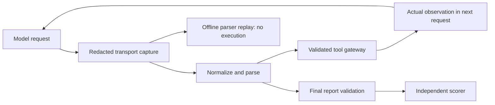

# Capability diagnostics and interaction evidence

Use **Open capability diagnostics** above the workspace model summary, or open `/diagnostics`. Selected model IDs and non-secret settings transfer into an editable configuration list. Launch the six-test ladder; status, per-case categories and Inspect / replay are shown together. This is a capability study, not B01–B05 qualification. Model providers may consume quota; all ladder tools are local.

| Case | Capability | Required operation |
|---|---|---|
| D01 | Follow instructions and return JSON | No tools; requested small JSON object |
| D02 | Read one frozen record | Read fixture and accurately report its code |
| D03 | Use a calculator | Call calculator for supplied numeric expression, report observed result |
| D04 | Formulate a calculation from words | Read invoice, extract values, calculate total |
| D05 | Resolve conflicting sources with evidence | Read archive and current notice, quote observed supporting text |
| D06 | Recover from a controlled failure | First primary read deliberately fails; use backup and report its release |

Every configuration runs D01–D06 consecutively. Independent cases use fresh memory and sessions; local models are prepared under the existing model lease. A guided workflow is not silently substituted for autonomous tool use. Passing simple diagnostics does not establish reliability on full tasks.

## Evidence and replay

Captured JSON HTTP request/response bodies include actual messages, schemas, inference settings, reported model identity, provider finish reason and usage. Authentication headers are never recorded. Known credentials are redacted; each body is capped at 256,000 UTF-8 bytes with truncation explicitly marked and a hash of the redacted body. Bounded bodies cannot be claimed as exact complete evidence. Streaming bodies are explicitly unavailable rather than being consumed by this recorder. Baselines record evidence by default; capture_diagnostics can disable it. Workspace traces also capture non-streaming transport bodies.

Attempt records contain interactions, agent traces, parsed actions, rejected text, tool executions, validation feedback and stop reasons. Diagnostic activity.jsonl preserves transport events while an attempt is running or if its worker is terminated. Each attempt JSON and study JSON remain local in diagnostic-results; reports include summary.json, comparison.csv and report.html. The authenticated evidence endpoint returns that attempt plus an offline replay.

Replay checks captured native call shapes or normalizes/parses recorded text using the advertised tool names. It never invokes a model, tool, calculator, or filesystem action. It does not replay the entire environment or prove factual correctness. Truncated/non-JSON bodies are flagged as unavailable for replay.

Native-tool requests now use a dedicated system instruction instead of simultaneously demanding textual Thought/Action/Observation syntax. Native assistant/tool history is included once. If a provider emits textual actions despite advertised schemas, actual observations are returned as runtime user messages rather than dropped. Prompt mode retains its textual protocol. Captured bodies allow this behavior to be audited; Auto is not proof that a response was native.

Identical calculator operations are blocked on the second request with feedback to use the previous observation; a third identical request ends the loop. Fixture caching remains per-run. Writes/stateful tools are not cached. B02 pre-final validation now requires required sources to have been read, an integer loan period, and exact nonempty quotations from observed source documents. It never supplies the expected answer. The independent scorer remains unchanged and detects wrong but plausible facts.

## Baseline scheduling and subsets

The baseline page offers configuration_first (default), task_first and counterbalanced ordering. Each configuration can use shared task checkboxes or specify its own B01–B05 subset. Required automatic tools use that configuration's subset. Progress, summaries and CSV/HTML exports show only scheduled cases and distinguish not selected. Compare models on common tasks; unequal task sets are not equivalent aggregate evaluations.

Selected subsets, order and execution-contract version affect resume identity; resume rejects mismatches. New scheduling/recovery results must not be pooled silently with historical runs. Execution order is saved in the experiment. Cancellation preserves completed cases and resume skips them.

## CLI

Run from repository root:

    .venv\Scripts\python.exe -m benchmarks.diagnostics --config benchmarks/configs/diagnostic-four-models.json --output diagnostic-results/<new-id>

Resume with the identical config and --resume. Replay a saved attempt with --replay diagnostic-results/<id>/<attempt-id>.json. The configured reference model is Groq qwen/qwen3.8-27b, followed by local Qwen3.5 Q6_K, Qwen2.5 Coder 7B and TinyLlama 1.1B. Parameters: temperature 0, 10 iterations, 2048 output tokens, 400 seconds, Auto, one case per diagnostic. Provider SDK retries are disabled in metered calls so requests are not invisibly retried. Confirmed quota failures are recorded, not bypassed with paid fallbacks.

Implementation uses the existing OpenAI-compatible SDK clients, HTTPX event hooks, production Agent/ReAct loop, shared UACP gateway and local frozen fixtures. Existing creators and dependencies are acknowledged in [credits](credits-and-sources.md). No upstream tool execution or fixture answers are simulated in a live diagnostic result.

## Explicit JSON-call compatibility follow-up

The initial diagnostic-v2 study revealed Qwen2.5 writing complete JSON call envelopes as ordinary assistant text. A separate diagnostic-v3-json-call revision handles exactly one object with exactly name and arguments, an advertised tool name and object arguments, optionally enclosed in a JSON fence. This bridge is enabled only in Auto. It never extracts calls from prose, dispatches arrays/multiple objects, accepts unknown tools or bypasses the normal required-argument/gateway validation. Native mode retains its explicit route; ordinary final reports remain final reports. Actual route json_call_v1 is recorded in response metadata.

The original 24-case study is preserved. A separately versioned Qwen2.5 follow-up uses the same six cases and unchanged numeric settings; no fixture, score target or task instruction was changed for that follow-up. Offline replay is labeled with its current adapter version; applying a newer parser to an old response is a compatibility comparison, not a claim that the original execution took that path.

The approved Groq quota follow-up uses 512 output tokens and model_min_interval_seconds=60. Pacing applies between model requests and between diagnostic cases; cooldown is cancellable and shown in progress. It remains a separate study, not a replacement for the matched 2048-token cases. Diagnostic resume identities include fixture and runtime-source hashes to reject pooling across changed code or inputs.
